# Satu Langkah: working prototype

**One object. One word. One step at a time.**
A kids' learning app where **Cil si Kancil** (Sang Kancil, the mouse-deer from Malaysian folk tales) guides autistic pupils in Standard 1–3 through real classroom objects and KSSR Bahasa Melayu words. It's useful for any pupil who needs clear steps. This is a concept prototype for the **Festival Idea Putrajaya (FOI) 2026 Innovation Challenge** (Edutainment, IPT category).

**▶ Live app:** https://sazweena.github.io/kawan-kata/ · recording mode: https://sazweena.github.io/kawan-kata/?demo&nobadge · home-practice mode: `?mode=latihan`
You can install it from the browser: it's a PWA with its own app icon.

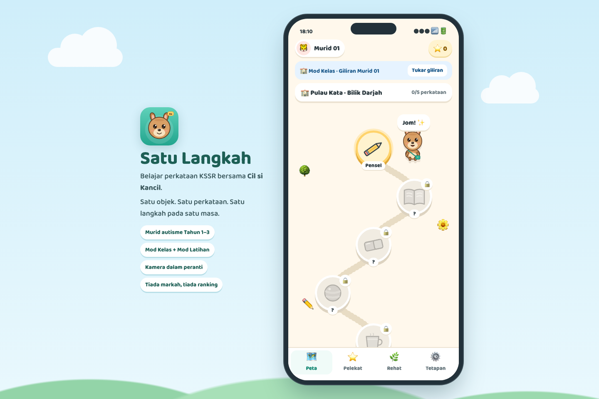

| Splash | Pulau Kata map | Mission | Camera |
|---|---|---|---|
| 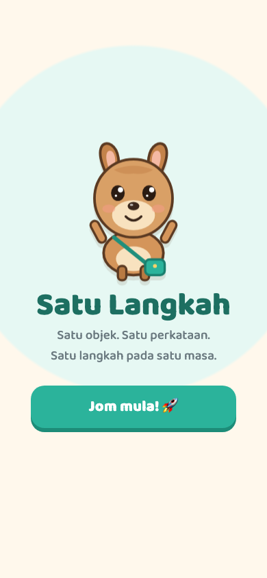 | 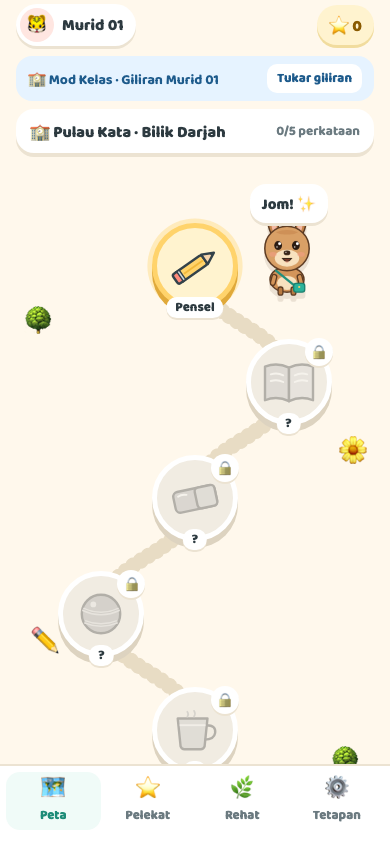 | 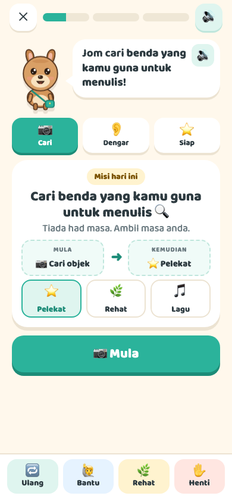 | 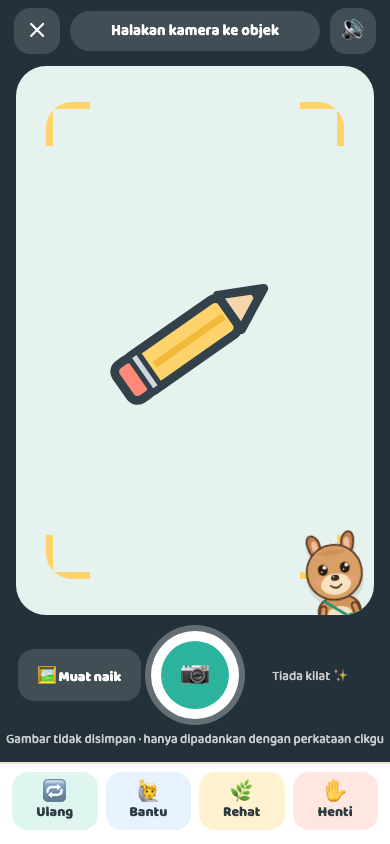 |
| **Adakah ini pensel?** | **Game 1: Dengar & Pilih** | **Game 2: Bina Perkataan** | **Hebat!** |
| 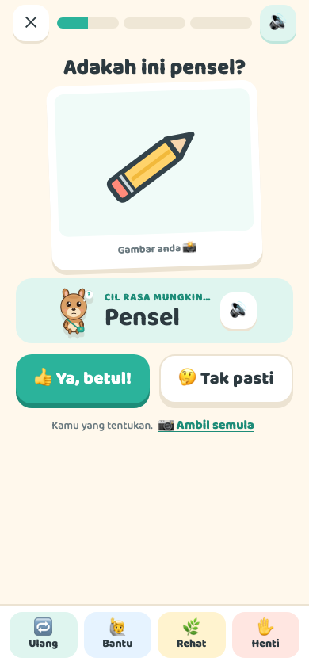 | 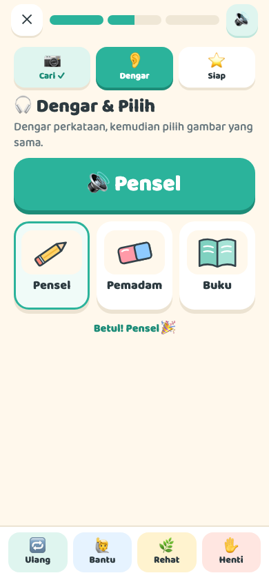 | 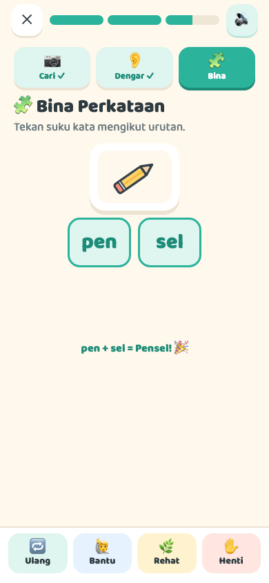 | 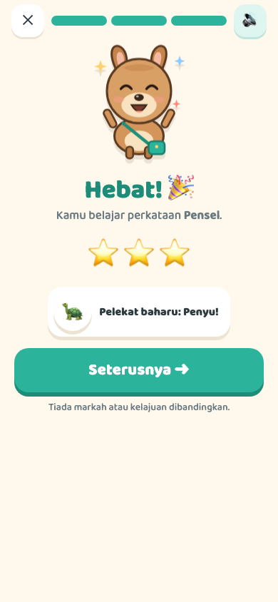 |
| **Buku Pelekat** | **Rehat** | **Paparan Cikgu** | |
| 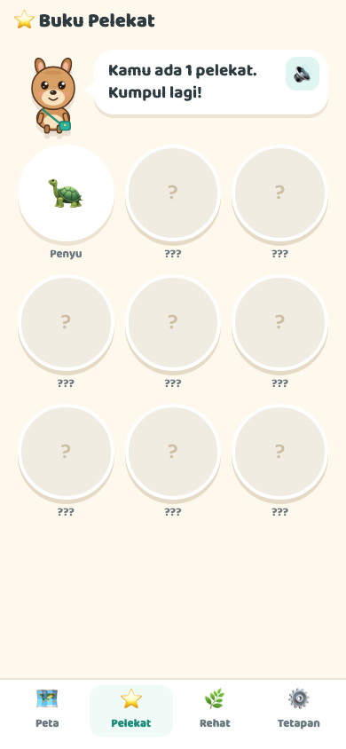 | 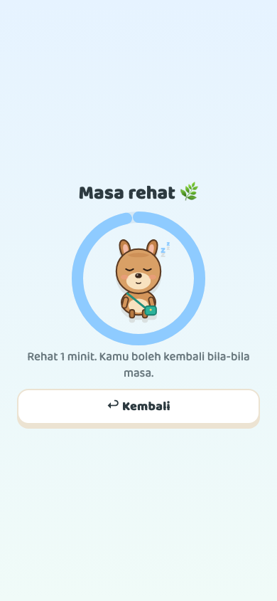 | 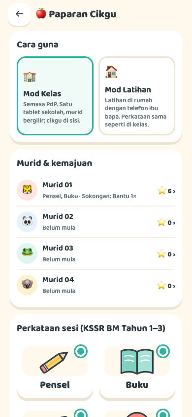 | |

## How it's used: who holds the device?
- **🏫 Mod Kelas (default):** used during the lesson on a school or teacher tablet. Pupils take turns ("Tukar giliran") with the teacher beside them. PPKI classes are small, so 1–2 tablets are enough.
- **🏠 Mod Latihan:** the same words as home practice on a parent's phone, about 10 minutes with a parent.

The teacher picks the mode in **Paparan Cikgu** (Settings → 🍎, then press and hold for 2 seconds, so children don't open it by accident).

## Flow
Splash → **Siapa yang belajar?** (who is learning?) → **Pulau Kata** map (one stop per word) → **Misi** (mission: Cil's mission, a 3-step schedule and a "Mula → Kemudian" (first → then) reward choice) → **Kamera** (camera) → **Adakah ini…?** (is this…?; the AI suggests, the child decides) or **Saya belum pasti** (I'm not sure yet; choose from the teacher's words) → **🎧 Dengar & Pilih** (listen and pick) → **🧩 Bina Perkataan** (build the word from syllables) → **Hebat!** (great!: stars + sticker) → back to the map.

The support buttons 🔁 Ulang · 🙋 Bantu · 🌿 Rehat · ✋ Henti (Again · Help · Break · Stop) are always in the same place.

**Teacher view:**
- Mod Kelas / Mod Latihan
- per-pupil progress (words, attempts, supports used, notes)
- choose the session's words, or **+ Tambah perkataan** (add your own word with a photo and syllables)
- settings: voice, Bina Perkataan, Mula → Kemudian, stickers, break timer
- **🖨️ Cetak kad kertas** (print paper cards)

## Run it
```bash
cd kawan-kata
python3 -m http.server 8765
```
Then open **http://localhost:8765** in Chrome, or just use the live link above. The camera only works on `localhost` or https, so opening `index.html` by double-clicking won't give you a camera.

| URL | Use |
|---|---|
| `http://localhost:8765/` | Real camera + on-device object recognition (TensorFlow.js MobileNet, loaded from a CDN, so you need internet) |
| `http://localhost:8765/?demo` | **For recording:** the camera is replaced by a drawn pencil, and every snap suggests "Pensel". Shows a small DEMO badge |
| `http://localhost:8765/?demo&nobadge` | Same, without the badge, for the final video |

### Keyboard shortcuts while recording
- **U**: the next "Ambil gambar" (take photo) returns **"Saya belum pasti."** (I'm not sure yet), to show the fallback.
- **D**: turn demo mode on or off.

## How the AI works (and the privacy claim)
- Matching uses a **closed word set**. The model's guesses only count if they map to one of the teacher's selected words: pen or pencil → Pensel, eraser → Pemadam, any ball → Bola, cup or mug → Cawan, book or binder → Buku.
- If the score is below 0.15, the app **never guesses**. It goes to "Saya belum pasti."
- Even when it's confident, the child confirms ("Ya, ini"), so a match is never shown as fact.
- Recognition runs **in the browser on the device**. The photo is held only in memory for the current word and discarded on the "selesai" (finished) screen. Nothing is uploaded or saved. Only the sound, text-size and animation settings are kept, in browser storage.
- Voice uses the browser's speech engine: a Malay voice if the device has one, otherwise Indonesian, otherwise the default. On a Mac, add a Malay voice under System Settings → Accessibility → Spoken Content, and check how it sounds before recording.

## Known limits (be honest if asked)
- Recognition uses a general model (ImageNet). Pencils are often seen as "pen", which we treat as Pensel, and some objects simply won't match. That's exactly when the "Saya belum pasti" fallback appears.
- A real product would use a model trained on KSSR classroom objects, which is what the R&D grant would pay for.


## Design principles & references
v3 visual style: a winding lesson path with round stops, one big chunky button per screen, a mascot narrating every screen, rounded type (Baloo 2), and a sticker book, as in **Duolingo ABC**, **Khan Academy Kids** and **Lingokids**. It's toned down for autistic learners: soft pastels, no timers or rankings, no flashing, gentle "sparkle" only (switched off by *prefers-reduced-motion* or "Kurangkan animasi" (less animation)), and text always shown with the voice.

| Pattern | Where it comes from |
|---|---|
| Simple colours, plain words, descriptive buttons, simple consistent layouts, no autoplay or motion | GOV.UK / Home Office, *Designing for users on the autistic spectrum* ([poster](https://ukhomeoffice.github.io/accessibility-posters/autism), [blog](https://accessibility.blog.gov.uk/2016/09/02/dos-and-donts-on-designing-for-accessibility/)) |
| Visual schedule with an "all done" column and audio/visual confirmation; first–then board; waiting/break board with an optional timer | Choiceworks ([App Store](https://apps.apple.com/app/choiceworks/id486210964), [BridgingApps](https://bridgingapps.org/bridgingapps-featured-app-choiceworks-2/)); First Then Visual Schedule ([App Store](https://apps.apple.com/us/app/id624035410)) |
| Audio layer on every screen, icons over text, slow narration, big touch targets, no complex gestures | Khan Academy Kids ([blog](https://blog.khanacademy.org/supporting-english-language-acquisition-with-khan-academy-kids/)); Google, [Designing engaging apps for kids](https://developers.google.com/building-for-kids/designing-engaging-apps) |
| Fixed button positions (motor planning); colour-coded word cards | Proloquo2Go ([AssistiveWare colour coding](https://www.assistiveware.com/support/proloquo2go/appearance/color-code-page-background), [Crescendo](https://medium.com/@AssistiveWare/proloquo2go-4-0-goes-deeper-into-the-core-of-communication-with-crescendo-940ccde3b964)) |
| Calm, uncluttered screens; sticker rewards; adjustable sound/colour; teacher progress view | Otsimo ([App Store](https://apps.apple.com/app/id1475410615), [review](https://www.theautismdad.com/2019/06/23/review-otsimo-is-a-fantastic-educational-app-for-kids-with-autism/2)) |
