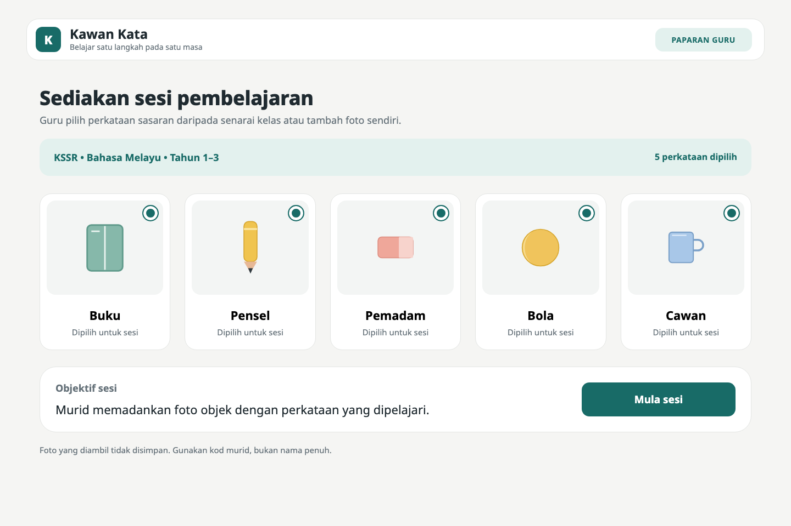
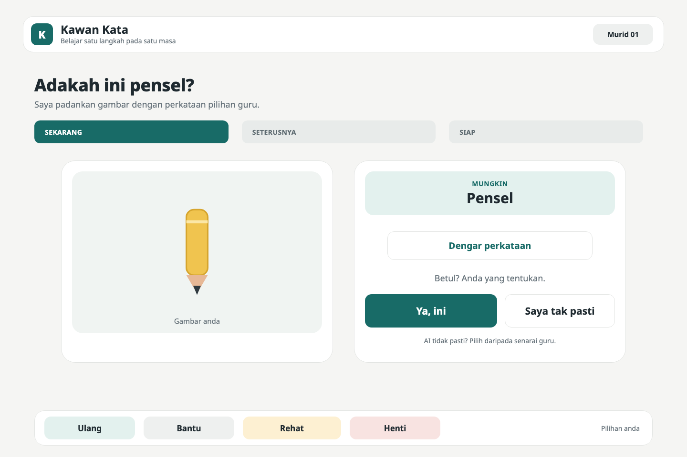
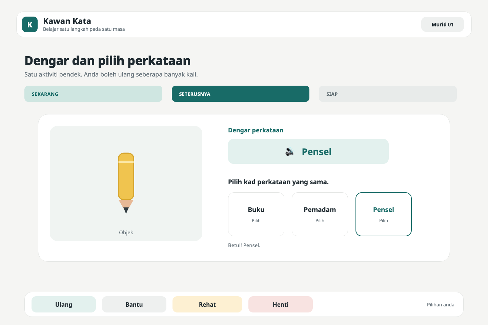
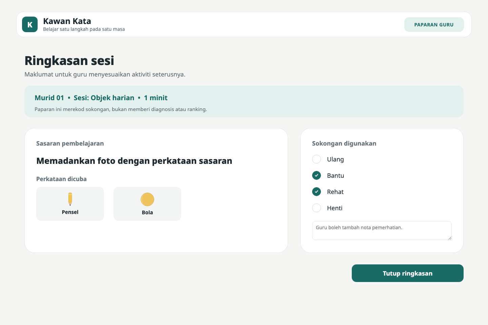

# Kawan Kata: working prototype

**One object. One word. One step at a time.**
A calm, step-by-step app that turns a real classroom object into a short KSSR Bahasa Melayu word lesson for autistic pupils in Standard 1–3 (PPKI/PPI), and any pupil who needs clear steps. This is a concept prototype for the **Festival Idea Putrajaya (FOI) 2026 Innovation Challenge** (Edutainment, IPT category).

**▶ Live demo:** https://sazweena.github.io/kawan-kata/ · recording mode: https://sazweena.github.io/kawan-kata/?demo

It's a static web app built from the team's mockups (see [`mockups/`](mockups/)). It has no build step and no server code.

| Setup (teacher) | "Adakah ini pensel?" | Listen & pick | Teacher summary |
|---|---|---|---|
|  |  |  |  |

## Run it
```bash
cd kawan-kata
python3 -m http.server 8765
```
Then open **http://localhost:8765** in Chrome, or just use the live link above. The camera only works on `localhost` or https, so opening `index.html` by double-clicking won't give you a camera.

| URL | Use |
|---|---|
| `http://localhost:8765/` | Real camera + on-device object recognition (TensorFlow.js MobileNet, loaded from a CDN, so you need internet) |
| `http://localhost:8765/?demo` | **For recording:** the camera is replaced by a drawn pencil, and every snap suggests "Pensel". Shows a small DEMO badge |
| `http://localhost:8765/?demo&nobadge` | Same, without the badge, for the final video |

### Keyboard shortcuts while recording
- **U**: the next "Ambil gambar" (take photo) returns **"Saya belum pasti."** (I'm not sure yet), to show the fallback.
- **D**: turn demo mode on or off.

## Screens (match the mockups)
1. **Sediakan sesi pembelajaran:** the teacher ticks words (Buku, Pensel, Pemadam, Bola, Cawan) → **Mula sesi**
2. **Hai! Kita belajar tentang objek:** the mission "Cari satu objek" → **Mula**
3. **Ambil gambar satu objek:** live camera with frame corners → **Ambil gambar**
4. **Adakah ini pensel?:** "MUNGKIN …", **Dengar perkataan**, **Ya, ini** / **Saya tak pasti**
5. **Saya belum pasti.:** choose from the teacher's words; "Ambil gambar semula" (take the photo again)
6. **Dengar dan pilih perkataan:** hear the word and pick the matching card; a wrong pick shows "Tidak mengapa…" (that's okay) with no penalty
7. **Bagus, sesi sudah selesai.:** **Selesai** or "Seterusnya: belajar perkataan lain"
8. **Ringkasan sesi (Paparan guru):** words attempted plus supports used (Ulang / Bantu / Rehat / Henti), and a note box

Always on the bottom bar:
- **Ulang:** repeats the instruction aloud
- **Bantu:** "Cikgu sudah dimaklumkan" (the teacher has been told)
- **Rehat:** a calm break screen, with no timer
- **Henti:** stop, which goes to the summary
- **Pilihan anda:** sound, large text, reduced animation

## How the AI works (and the privacy claim)
- Matching uses a **closed word set**. The model's guesses only count if they map to one of the teacher's selected words: pen or pencil → Pensel, eraser → Pemadam, any ball → Bola, cup or mug → Cawan, book or binder → Buku.
- If the score is below 0.15, the app **never guesses**. It goes to "Saya belum pasti."
- Even when it's confident, the child confirms ("Ya, ini"), so a match is never shown as fact.
- Recognition runs **in the browser on the device**. The photo is held only in memory for the current word and discarded on the "selesai" (finished) screen. Nothing is uploaded or saved. Only the sound, text-size and animation settings are kept, in browser storage.
- Voice uses the browser's speech engine: a Malay voice if the device has one, otherwise Indonesian, otherwise the default. On a Mac, add a Malay voice under System Settings → Accessibility → Spoken Content, and check how it sounds before recording.

## Known limits (be honest if asked)
- Recognition uses a general model (ImageNet). Pencils are often seen as "pen", which we treat as Pensel, and some objects simply won't match. That's exactly when the "Saya belum pasti" fallback appears.
- A real product would use a model trained on KSSR classroom objects, which is what the R&D grant would pay for.
